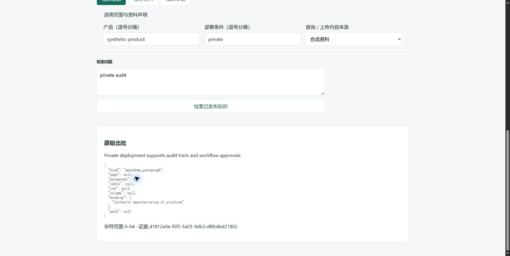
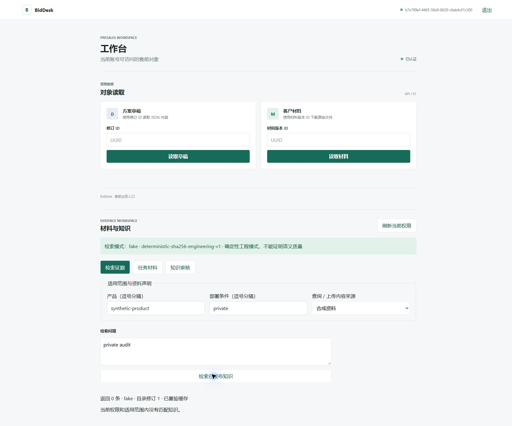

# 二A外部前置交付记录

日期：2026-11-11（Asia/Shanghai）。本报告记录本轮工程实现和实际验证，不更新STATUS，不代表二A产品验收或二B进入批准。

本次文档复核仅依据当前真实探针JSON及固定开发输入更新D3事实与进入判断，不重新调用模型或数据库。下文工程测试和浏览器数字为此前交付的历史结果，本次未重跑。

## 本次交付说明

本轮目标是补齐二B所需的二A外部前置。新增2A-2共享受限检索、只读Product Catalog MCP，以及2A-3最小材料/知识审核/检索/证据定位页面和业务HTTP入口。沿用已有JWT、当前角色/来源闭包、材料登记/解析/输入清单、知识版本/独立审核/索引构建和维护授权服务，没有另建ACL或产品事实库。

使用顺序：维护流程先建立资源和授权；架构师登录后选择有权任务/文档、登记文件、分类任务材料并解析，查看逐文件失败/必需输入状态；知识候选解析后构建索引并提交固定发布/替换/停用动作；独立审核人登录后审核；有权读者按产品/部署范围查询已发布知识并读取稳定证据ID和原始定位。刷新要求重新登录；到期退出并清除工作区；重登后按当前权限重新读取。权限/目录修订变化时清除受限查询状态，后台每15秒核实且可手动刷新；这不是对浏览器已收到内容的远程撤回保证。

检索在短事务中先核实当前主体、来源闭包、就绪、发布状态和适用范围，再读取允许构建的块；BM25统计及物化向量距离查询仅覆盖同一允许集合。两路各20候选、RRF常数60、最终最多8条；稳定ID打破并列。Embedding请求/精排在事务外运行，返回前重验当前权限/目录修订。目录冲突、索引模型/维度/模式不匹配明确失败，不能任意选旧版本。Embedding失败保留可见关键词降级；精排失败保留RRF并标记；失败降级结果不缓存。缓存身份包含主体、授权修订、目录修订、查询、范围和所有检索配置，命中仍重新读取允许来源。

MCP只注册`lookup_capabilities`，服务端固定已发布知识范围，不能读取任务材料或调用发布写工具。后端签发指定audience、60秒、绑定产品/部署范围的凭证，放在传输metadata，不放业务参数；子进程仅继承运行所需配置。业务API、stdio和直接共享服务调用统一权限/来源门禁。成功空结果与无权/失败分别返回；历史证据可读性仍由当前来源权限控制，停用排除新检索但不销毁历史出处。

示例：修改前，售前人员只能按ID下载材料/读取草稿，不能在浏览器查看解析、审核和检索结果。现在架构师可提交一份合成平台能力文档，审核人独立发布后，销售检索“private audit”查看原始段落；撤销知识授权后刷新查询返回0条，重登也不能恢复旧权限。该演示使用显式Fake Embedding，只证明工程流程与边界。

## 进入证据与未完成项

| 前置/退出证据 | 实际结果 | 限制与后续 |
| --- | --- | --- |
| D1：2A-2，AC04/05/06、AC16检索部分、AC22 | 共享检索/只读MCP实现；真实PostgreSQL 18.6/PGVector 0.8.6、stdio往返、缓存/撤权/停用/非法输入/降级反例已运行 | Fake模型不能证明语义召回、引用支持或模型质量；真实精排服务未运行 |
| D2：2A-3、二A认证/真实API联调 | React页面、业务API、生成DTO、类型/构建和真实浏览器流程已验证 | 浏览器为本轮实际操作记录，无已安装的Playwright/自动浏览器依赖；未声称持久浏览器E2E套件已建立；文件上传由真实DB HTTP测试覆盖，浏览器上传文件动作未执行 |
| D3：架构第7.1节早期真实探针 | 当前报告为`basic_chain_observed_not_acceptance`：真实`qwen3.7-text-embedding-flash`、1024维；预检通过；16请求、844字符、8.105秒；10例均命中预期来源段落；全部保留RRF降级 | 原Embedding配置/未运行阻塞已解除，但开发输入仍为草案，未见其执行前复核/接受记录及人工相关性判断记录。因此真实链路执行证据已具备，D3完整退出证据仍有缺口，不能直接标为满足；不代表P07、二A整体验收或真实精排通过 |
| 二B D0及进入评审 | 本次未改变上游待评审状态，不实施二B；原始用户对2B-0的实施范围授权继续保留 | 不能从二A调用授权或本次报告更新推导整份二B设计已获接受；任务1仍需核对D0、D1/D2历史证据、D3样例复核缺口和D4可复用基础，不新增重复实施授权要求 |
| AC16其余部分 | 未实现 | 固定方案提交/审批证据复核及历史方案影响归阶段三 |
| 阶段五冻结验收/Linux/Compose | 未执行 | 不属于本轮外部前置实现，不将本机工程结果当作部署或冻结验收 |

探针工件：[开发输入](phase2a-probe-development-2026-11-11.json)、[历史模型发现](phase2a-model-discovery-2026-11-11.json)、[当前真实Embedding探针报告](phase2a-real-probe-2026-11-11.json)。开发输入摘要为`277865a4e47678fc9a110f2d48676b288995aea34665f4b43ad7771cfcb5939e`，本次只读重算与报告一致。此前未发现Embedding配置、0请求的前检属于历史失败，不能继续作为当前运行结论；此前独立[千问预检阻塞记录](phase2a-qwen-d3-attempt-2026-11-11.md)保持原样，不覆盖其历史。当前JSON已经记录实际真实调用，但未提供本次进程退出码和绝对起止时间，本次不补造。

### 当前真实探针事实核对

| 核对项 | 当前JSON及开发输入的可核验结果 |
| --- | --- |
| 模式/状态 | `real`；`basic_chain_observed_not_acceptance`；`d3_started=true` |
| 模型/端点 | `qwen3.7-text-embedding-flash`，1024维；`https://maas.qianwenaiapi.com/compatible-mode/v1/embeddings` |
| 预检 | `passed`；响应模型身份精确匹配、1个1024维有限数值数组；本次只核对已保存的通过记录，不重发请求 |
| 请求与预算 | 16条连续编号调用记录全部`validated`：1次单文本预检、5次各4条的索引Embedding、10次单查询Embedding；字符明细之和为844，累计8.105秒；分别未超过20请求、12,000字符、600秒 |
| 批次 | 配置上限20条，实际最大4条，未超限 |
| 开发数据 | 10例草案、5文档20段落（含15段干扰）；输入摘要与报告一致，未变更输入或标签 |
| 命中与定位 | 10例均为`retrievable`、`missing_sources=[]`；逐例交叉核对了预期正文、来源版本一致性及Markdown第1段定位/字符范围；全部预期段落位于前3条，未只依赖脚本的成功标签 |
| 缓存/降级 | 10例均`cache_hit=false`；每例唯一降级为`reranker_not_configured_rrf_retained`，没有Embedding失败后关键词兜底标记；未运行真实精排 |
| 费用 | `unknown_no_amount_cap`：用户未设金额上限，实际金额未知；请求/字符限制不能换算为已知费用 |

以上仅证明该合成输入、实际配置与预算下，真实Embedding参与的受限检索链已运行，并保留预期来源段落及出处。10/10是本次开发草案的检查结果，不是P07的Hit@8/Recall@8、冻结样本三轮评分或通用语义质量结论；检索到冲突/风险/不支持相关文本，也不等于系统已能作出正确的冲突裁决、风险判断或方案承诺。未配置精排而保留RRF是已记录的允许降级，不应单独当作基本不可行，也不能称精排通过。本次报告没有显示基本链路不可行；它亦不承担证明全部工程硬门禁通过的职责，相关权限证据仍需结合D1/D2。

### 开发样例草案对D3退出的影响

[总体架构第7.1节](../superpowers/specs/总体架构设计.md)明确要求执行前固定已批准的开发样例，尚未制作复核时先完成准备，并留存人工相关性判断。当前开发工件仍为`development_draft_not_frozen_acceptance`；现有专项计划也明确“10个开发样例草案”。本次相关资料未见将这些具体输入/预期来源复核接受的可追溯记录。P07批准10个开发样例的组成，以及用户批准模型/端点/预算和实际调用，不能自动替代对具体样例与标注的复核。

本次已作输入摘要、逐例来源正文/定位与预算的事后静态交叉核对，这提高了结果可复核性，但不是人工业务相关性评审，也不虚构执行前接受记录。因此D3结论应是“真实链路执行部分已满足；样例复核及相关性证据未闭合，暂不标记完整满足”，而非继续称缺Embedding配置或一概未执行。

后续应先查验是否已有与该摘要对应、可追溯的执行前样例复核和相关性记录；如有，据实补入证据索引即可，不因文档更新重复调用模型。如实际没有，则如实登记执行前数据就绪门禁的缺口，先补具体输入/预期标注的复核，再由二B任务1按既有基线判断本次报告能否作为进入依据，或需要在已复核输入上补证。事后复核不能写成“执行前已批准”；若输入/标签被修订，旧报告只适用于旧摘要。这里不批准豁免、不自动重跑，也不修改设计结论。

## 修改文件及作用

以下排除开工前既有的两份设计修改、二B清单和WorkBuddy笔记，均未触碰。未改AGENTS、CLAUDE、GLOSSARY、STATUS、需求基线、依赖清单/锁文件；未安装依赖、commit、push或部署。

| 文件 | 作用 |
| --- | --- |
| `src/presales/retrieval/__init__.py` | 共享检索包 |
| `src/presales/retrieval/models.py` | 输入范围、配置、证据和结果Pydantic契约 |
| `src/presales/retrieval/ranking.py` | 确定性BM25与RRF |
| `src/presales/retrieval/service.py` | 当前授权检索、精排、缓存重验、历史证据/轨迹受限读取 |
| `src/presales/infrastructure/product_catalog.py` | 只读stdio服务/客户端、范围凭证、最小环境和10秒调用期限 |
| `src/presales/application/workbench.py` | 业务组件装配、当前工作区和材料/知识状态读取、Windows loop factory |
| `src/presales/api/knowledge.py` | 严格业务DTO、当前主体、材料/知识/检索/MCP路由和错误响应 |
| `src/presales/api/app.py`、`src/presales/api/auth.py` | 在售前入口注册新增业务服务，保持通用兼容入口隔离 |
| `migrations/versions/0005_retrieval.py` | 追加式主体绑定检索轨迹及最小SQL权限；真实执行仅在临时库 |
| `frontend/src/KnowledgeWorkbench.tsx` | 材料分类/解析、知识索引/独立审核、检索和原始定位 |
| `frontend/src/contracts.generated.ts` | 从后端契约生成检索/写入DTO，不维护另一套枚举 |
| `frontend/src/api.ts`、`main.tsx`、`styles.css` | 业务客户端、会话代次/自然到期、页面装配和响应式样式 |
| `scripts/export_presales_dto.py` | 无新依赖的DTO导出和漂移检查 |
| `scripts/check_presales_workbench.py` | 临时合成HTTP/静态页面、60秒测试token、受控撤权/停止入口 |
| `scripts/test_presales_postgres.py` | 新增独立`--workbench`/`--probe`档；保留既有pytest180秒期限及默认配置 |
| `scripts/probe_presales_retrieval.py` | 固定开发输入、模型目录发现、显式真实Embedding探针和累计请求/字符/时间预算 |
| `tests/presales/test_retrieval_units.py`、`test_retrieval_postgres.py` | 排名/非法输入、真实范围过滤/缓存/停用/撤权/失败降级 |
| `tests/presales/test_product_catalog.py` | 凭证/工具/环境边界、真实stdio与共享检索一致性及撤权重放 |
| `tests/presales/test_workbench_api.py` | PostgreSQL-backed API、角色、自审批、上传/解析/清单、幂等与旧修订 |
| `tests/presales/test_phase2a_tools.py` | DTO漂移、固定数据/干扰语料、探针预算、显式执行和uvicorn loop factory回归 |
| `docs/superpowers/plans/2026-11-11-phase-two-a-prerequisites.md` | 本轮边界、退出证据、探针数据/预算/运行约定 |
| `docs/maintenance/phase2a-*-2026-11-11.json`、本报告 | 模型发现、开发输入、真实前检与实际交付证据 |
| `docs/maintenance/phase2a-workbench-{source,revoked,relogin}-2026-11-11.png` | 真实浏览器来源定位、撤权和重登截图 |

前端构建生成的`tsconfig.tsbuildinfo`已恢复至开工时干净内容；未将它作为交付。`dist`为构建产物，不作为源码完成证据。

## 实际验证

本节保留此前工程交付期间的实际命令与历史结果；本次仅更新真实探针行的历史/当前区分，不重新宣称这些工程命令本次通过。本次文档核对见下节。

命令中的`--no-sync`保证使用已安装依赖，不执行依赖同步。普通Python入口/DTO命令前设置当前进程`$env:PYTHONPATH = 'src'`；pytest沿用项目配置。运行环境Windows、Python 3.13、本机临时PostgreSQL 18.6、PGVector 0.8.6；不连接业务库。API多数自动用例为真实数据库加ASGI transport，另由实际浏览器访问真实uvicorn TCP入口补联调。

| 命令原文 | 实际结果 |
| --- | --- |
| `git status --short`；`git diff --stat` | 成功；开工4项既有变更，两份已跟踪文档合计52新增/16删除；结束核对其numstat未变 |
| `uv run --no-sync pytest tests/presales -q -rs` | 开工基线72通过、55跳过、0失败；首次沙箱执行因uv缓存拒绝访问退出，获准环境重跑取得该结果 |
| `uv run --no-sync pytest -q -rs` | 最后一次全量默认回归287通过、69跳过、0失败；其中真实DB/容器沿用既有opt-in、Windows符号链接权限跳过，不计通过 |
| `uv run --no-sync python scripts/test_presales_postgres.py --pg-bin 'C:/Program Files/PostgreSQL/18/bin' --check-vector --pytest-args -q -rs` | 最终159通过、1跳过、0失败，97.08秒；唯一跳过为Windows未授予符号链接创建权限。此前完整运行158通过、1跳过、0失败（当时未增加最后一条上传用例），两次数量不拼接 |
| `uv run --no-sync python scripts/test_presales_postgres.py --pg-bin 'C:/Program Files/PostgreSQL/18/bin' --check-vector --pytest-args -q -rs -k retrieval` | 20通过、133未选中、0失败 |
| `uv run --no-sync python scripts/test_presales_postgres.py --pg-bin 'C:/Program Files/PostgreSQL/18/bin' --check-vector --pytest-args -q -rs -k 'retrieval or product_catalog or workbench'` | 首轮27通过、2失败、127未选中；失败为新增列表SQL不存在列、Windows MCP事件循环，已定位修复 |
| `uv run --no-sync python scripts/test_presales_postgres.py --pg-bin 'C:/Program Files/PostgreSQL/18/bin' --check-vector --pytest-args -q -rs -k 'product_catalog or workbench'` | 修复复验9通过、147未选中、0失败 |
| `uv run --no-sync python scripts/test_presales_postgres.py --pg-bin 'C:/Program Files/PostgreSQL/18/bin' --check-vector --pytest-args -q -rs -k workbench` | 最后工作台专项3通过、157未选中、0失败，包含上传/解析/输入清单/幂等回执 |
| `.venv/Scripts/ruff.exe check` | 通过，0违规 |
| `.venv/Scripts/ruff.exe format --check` | 失败：11个本轮未改动文件会被格式化、151文件已格式化；未顺手修改旧文件 |
| `.venv/Scripts/ruff.exe format --check src/presales/retrieval src/presales/application/workbench.py src/presales/api/knowledge.py src/presales/api/app.py src/presales/api/auth.py src/presales/infrastructure/product_catalog.py migrations/versions/0005_retrieval.py scripts/export_presales_dto.py scripts/check_presales_workbench.py scripts/test_presales_postgres.py scripts/probe_presales_retrieval.py tests/presales/test_retrieval_units.py tests/presales/test_retrieval_postgres.py tests/presales/test_product_catalog.py tests/presales/test_workbench_api.py tests/presales/test_phase2a_tools.py` | 最终改动范围19个Python文件格式检查通过 |
| `.venv/Scripts/pyrefly.exe check` | 通过，0错误；工具另报11 suppressed、5 warnings not shown，不隐去此限制 |
| `npm run typecheck`；`npm run build`（`frontend/`） | 均通过，退出0；未运行`npm ci`，无依赖安装 |
| `.venv/Scripts/python.exe scripts/export_presales_dto.py --check` | 通过，生成DTO与后端契约一致 |
| `.venv/Scripts/python.exe scripts/probe_presales_retrieval.py --prepare --output docs/maintenance/phase2a-probe-development-2026-11-11.json` | 通过，准备10例草案；不是模型能力测试 |
| `uv run --no-sync python scripts/probe_presales_retrieval.py --discover-models --output docs/maintenance/phase2a-model-discovery-2026-11-11.json` | 一次真实只读请求成功；2模型、0个名称匹配的检索候选；不是Embedding可行性证明 |
| `uv run --no-sync python scripts/test_presales_postgres.py --pg-bin 'C:/Program Files/PostgreSQL/18/bin' --check-vector --probe` | 历史首次运行配置阻塞，退出2、0次Embedding、0字符；现有JSON已由后续实际运行更新为真实链路已观测（16请求、844字符、8.105秒），详见当前事实表；本次未重跑该命令，不依据JSON反推后续进程退出码 |
| `uv run --no-sync python scripts/test_presales_postgres.py --pg-bin 'C:/Program Files/PostgreSQL/18/bin' --check-vector --workbench` | 最终启动成功，真实浏览器操作后通过本机控制文件正常停止，退出0，临时实例已停止；此前启动字段/loop factory错误保留为失败，不计通过 |
| `.venv/Scripts/pymarkdown.exe scan docs/superpowers/plans/2026-11-11-phase-two-a-prerequisites.md` | 通过 |
| `.venv/Scripts/pymarkdown.exe scan docs/superpowers/plans/2026-11-11-phase-two-a-prerequisites.md docs/maintenance/phase2a-prerequisites-delivery-2026-11-11.md` | 通过 |
| Docker/容器/Linux、真实精排、阶段五冻结能力评测 | 未执行：不在本轮范围或缺配置；不推断通过 |

另有三次沙箱内直接`.venv/Scripts/python.exe -m pytest`专项未正常结束，已核对固定命令和PID后停止，结果为未完成，未计通过；获准环境的全量/真实专项覆盖相应测试。没有删除/放宽测试、改业务超时或切模式制造绿色。

### 本次文档核对与验证范围

本次唯一修改文件为本交付记录。执行`git status --short`、`git diff --stat`记录既有工作区差异；运行只读Python断言核对当前JSON状态/模型/维度/预检、开发输入SHA256、16条调用记录及字符求和、批次/预算、10例预期正文/定位、10例降级标记，全部通过。人工核对架构第7.1节及二B清单D0—D8/任务1进入规则，保留样例草案限制。文档格式命令为`.venv/Scripts/pymarkdown.exe scan docs/maintenance/phase2a-prerequisites-delivery-2026-11-11.md`。本次未运行pytest、前端构建、数据库、浏览器或模型调用，因为仅调整一份报告与证据解释，不涉及实现变更；历史数字不算本次测试结果。

## 浏览器操作证据

实际使用Edge、真实HTTP、临时真实PostgreSQL、显式Fake Embedding：架构师登录并构建/提交固定知识版本，审核人独立登录批准，销售检索/读取定位；架构师读取材料状态、标记必需、保存完整清单并解析至输入完整；刷新回登录页；合成销售知识撤权后刷新清空旧结果、新检索0条；60秒token自然到期后自动回登录；重登仍0条。未通过浏览器写入真实数据或外部系统。

## 风险与衔接建议

D1/D2已有工程实现及本机集成历史证据；D3现有真实Embedding检索链运行报告，原模型/端点/维度/未运行缺口已解除，但具体开发样例复核/接受及人工相关性证据尚未闭合，仍不能标记D3完整满足。真实精排未配置是明确降级，不另行提高为进入二B的强制条件；实际金额未知，不把未设金额上限误记为费用已核定。P07、二A整体及完整精排能力均未验收。

二B剩余进入条件按原清单处理：D0仍需可查的上游二B方案评审接受记录；用户此前已授权2B-0范围，不重复要求相同授权。任务1需汇总核对D1/D2报告、上述D3数据复核缺口及D4来源闭包/命令回执/修订基础，不能由本报告代替进入审查。D5受控checkpoint/存储由二B任务5/6产出，D7二B分析探针与D8运行页浏览器成果由后续任务产出，不是任务1的先验阻塞；D6可引用既有PostgreSQL 18.6/PGVector 0.8.6临时实例证据，真实执行时重新核实。不得把这些未来二B内部成果一并误列为当前二A缺失前置。

新增迁移head为`0005_retrieval`；后续二B迁移必须承接该head，不直接套用旧清单的`down_revision=0004_knowledge`。修改二B计划或其批准结论不在本轮内，进入评审时处理。当前常规HTTP命令在Windows需要报告所列Selector loop factory；尚未验证Linux、Compose或生产静态资源交付。

全仓格式门禁的11个未改文件应另开限定整理任务，不能把本轮范围格式通过写成全仓通过。Fake/真实数据库/真实浏览器分别证明相应工程边界，均不能替代真实模型能力。
