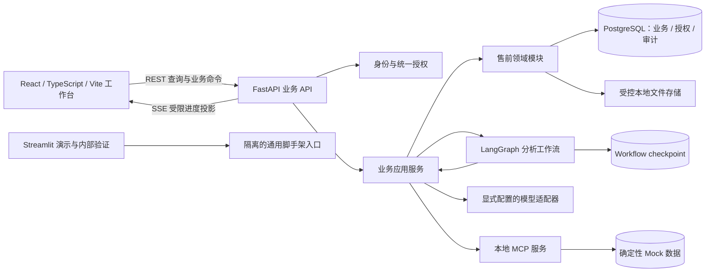

# 企业 AI 售前方案工作台：总体架构总览

- 文档版本：v0.1-review-draft。
- 更新日期：2026-11-06（Asia/Shanghai）。
- 状态：待架构评审；不是完整技术设计批准、开发授权或验收结论。
- 权威依据：[已批准业务需求基线](初版业务需求分析文档.md)、[需求决策索引](../../presales-requirements-decisions.md)、[领域术语](../../../GLOSSARY.md)。
- 详细设计记录：[总体技术设计与确认历史](总体技术设计.md)。
- UI方向：用户已确认双入口；接入顺序及工程约束见[双入口工作台与前端分阶段接入设计](双入口工作台与前端分阶段接入设计.md)。2A-0最小React工程已存在，核心工作台与业务页面尚未实现。

## 1. 目标与边界

本总览把已确认的技术方向收束为可评审的系统边界、模块职责、核心数据流、必须守住的不变量和分阶段交付路线。读者可用它判断整体结构是否能承载冻结的 v0.1 业务需求；数据库字段、事务细节、API 契约和执行恢复协议留在相应阶段方案中。

首版面向固定制造业场景的单租户本地演示。售前架构师先在授权商机下创建本地 Presales Task、准备材料和初步 Proposal Package；审核人随后单独批准精确的外部任务创建动作，系统才创建 External Task Record。之后架构师继续完善方案，审核人对固定 Proposal Version 和另一份明确的发布动作集合进行审批，再由确定性本地 MCP Mock 逐项执行和核实。外部任务创建批准不等于 Proposal Version 批准或正式发布批准。系统不替人承诺产品能力、价格、日期或合同义务。

本文引用 TD-001 至 TD-034 的已确认方向，其中核心UI安排已按2026-11-06的用户选择更新。方向确认不代表所有实现细节已经批准；当前代码包含继承的FastAPI/LangGraph/Streamlit脚手架、阶段一基础及登录/JWT和少量业务读取路由；React工作台、完整售前HTTP工作流、完整内容契约与产品验收尚未完成。本次仅静态核查，不重申旧测试结果为当前通过。

## 2. 当前代码与目标结构

| 区域 | 当前可核验代码 | 目标职责 |
| --- | --- | --- |
| 服务入口 | `src/service/`提供通用Agent API；`src/presales/api/`已有登录、身份及材料/草稿读取路由，未形成完整业务HTTP工作流 | 保留适用的FastAPI接入，所有售前操作进入业务应用服务并检查当前身份、权限和状态 |
| Agent/工作流 | `src/agents/` 是通用示例图和工具 | LangGraph 负责分析编排、节点执行、中断及恢复；业务记录仍由售前服务维护 |
| 持久化 | `src/memory/postgres.py` 封装 LangGraph PostgreSQL saver/store；阶段一新增独立 SQLAlchemy async engine 与 Alembic 迁移 | 独立管理工作流 checkpoint；业务记录由自己的数据库访问层和显式迁移负责 |
| Schema | `src/schema/` 以 Pydantic 请求/响应类型为主 | 继续承载接口 DTO；业务实体和数据库映射放在独立售前模块，避免把 API 类型当作持久化事实 |
| 客户端 | `src/streamlit_app.py`与`src/client/`提供通用聊天界面；`frontend/`已有2A-0最小React工程，核心工作台与业务页面尚未实现 | Streamlit用于聊天演示和内部验证；React + TypeScript + Vite逐阶段承担任务、证据、编辑、审批与发布恢复 |
| 数据库/文件 | `compose.yaml` 声明 PostgreSQL 16；代码有 SQLite/PostgreSQL/Mongo checkpointer 配置 | 首版目标为单 PostgreSQL 实例、按职责分 schema；客户文件和导出物放受控本地目录，数据库保存身份和元数据 |
| 外部工具 | 当前可见的是脚手架示例工具 | 两个项目本地 MCP Server 分别提供受限产品知识读取和确定性机会工作区 Mock；无真实 CRM |

此处描述目标归属，不表示以上售前能力已经实现。尤其现有 bearer key、请求中的 `user_id`、聊天 `thread_id` 和 checkpointer 不能直接代替业务 JWT、对象授权、Proposal Analysis Attempt 或审批门禁。

## 3. 逻辑架构

业务应用服务是权限与状态转换的统一入口。Agent 可读取被授权的数据并提交分析结果或动作建议；不能绕过服务层直接变更业务状态、审批、读受限来源或执行未经批准的外部写入。文件、模型、checkpoint 与 MCP 之间没有隐式共同事务。

Streamlit若联调售前对象，必须调用相同业务API并使用业务身份，不能以脚手架身份读取售前数据。后台分析不依赖浏览器连接存活；断线后重新鉴权、读取当前快照再接收进度，快照/订阅交接须避免遗漏终态。SSE不替代业务记录或完整审计，现有通用AG-UI不直接承担售前审批与恢复。

### 模块职责

| 模块 | 负责内容 | 不拥有的事实 |
| --- | --- | --- |
| 身份与访问控制 | 验证 JWT 主体；读取当前角色和对象授权；按归属及所有实际输入来源检查访问 | 不把 token 内旧权限当作当前授权；不因 schema 分组自动放宽访问 |
| 商机与任务 | Opportunity、本地 Presales Task、与其关联但生命周期独立的 External Task Record、输入清单及任务生命周期 | 不把外部任务记录与本地任务合并；不把聊天线程当作任务身份 |
| 材料与知识 | Customer Material、Published Knowledge Version、证据定位及来源适用性 | 不让文件名、向量索引或模型引用替代来源身份 |
| 分析执行 | Proposal Analysis Attempt、LangGraph thread 映射、节点运行、取消和恢复 | checkpoint 不是业务审批、版本或发布结果的权威记录 |
| 方案与审阅 | Proposal Version、不可变内容修订、Review Record、Approval Record | 审批不授权批准清单以外的动作；追加审计不改写已批正文 |
| 发布与工具 | Approved Action Set、逐项调用身份、MCP 幂等、未知结果核实和恢复 | 不把部分成功标成完成；不连接真实 CRM |
| 业务记忆 | 有来源的商机/客户陈述、确认状态、有效性、冲突和复用范围 | 不把模型推断或过期内容当成确定事实 |

这些职责在同一服务/部署中通过模块边界实现，不新增微服务。具体包路径是阶段方案中的实现建议。

## 4. 核心数据与权威来源

| 数据 | 权威来源 | 约束 |
| --- | --- | --- |
| 用户、角色、资源授权 | PostgreSQL 当前授权记录 | 三个预置账号各绑定一个角色；无匹配授权默认拒绝；重启不以种子配置覆盖已变更授权 |
| Opportunity、Presales Task 与 External Task Record | 本地 Opportunity/Presales Task 由 PostgreSQL 关系记录权威管理；External Task Record 由 Opportunity Workspace MCP 目标结果及本地核实记录共同追踪 | 本地任务和初步结果可先存在；精确创建动作须先有独立 External Task Creation Approval；创建批准不授权正式方案发布 |
| Proposal Version 内容 | 指定修订的 JSON/JSONB 快照 | 保存形成新修订；提交与批准绑定固定修订；正式批准正文不可变 |
| 来源依赖和 Evidence Snapshot | PostgreSQL 的直接依赖及版本关系 | 访问沿依赖追溯所有原始来源；未知、缺失、循环或权限不足时拒绝 |
| 审阅、审批与审计 | PostgreSQL 业务记录及追加事件 | 批准绑定精确快照与 Approved Action Set；审计追加，不修改历史正文 |
| 分析中间态 | LangGraph checkpoint | 服务端生成 thread 并绑定尝试；恢复前重新鉴权；checkpoint 不证明业务产物已就绪 |
| 文件正文 | 受控本地目录 | 业务身份、逻辑存储键、版本、校验和及来源在数据库登记；目录不作为公开静态资源 |
| MCP 目标结果 | 本地确定性 Mock 与业务核实记录 | 批准动作标识作为幂等键；不能验证幂等或结果未知时，不重复写入、不宣称发布完成 |

## 5. 端到端业务路径

1. 本地初始化演示 Opportunity 和授权；售前架构师在授权商机下创建 Presales Task，登记客户材料及来源声明；数据使用合成材料或获授权的公开/自有资料。
2. 后端保存来源身份、内容版本和归属，检查用户对商机、任务及材料的当前授权。
3. 创建 Proposal Analysis Attempt，绑定发起人、输入修订、来源范围及服务端生成的 LangGraph thread；通过统一的业务访问组件提供可见上下文。
4. 受限 Agent 生成带来源依据的覆盖结论、初步方案、风险和澄清项。结构化结果及其直接来源依赖按修订保存；失败、降级、未知和部分成功显式留痕。
5. 架构师提交独立的 External Task Creation Approval 请求，绑定目标、精确参数和来源范围；审核人批准后，发布服务才可通过 Opportunity Workspace MCP 创建 External Task Record。未批准或创建结果未知时，本地材料和方案仍保留，不能伪称外部任务已创建；该批准不授权方案发布。
6. External Task Record 创建并核实后，架构师处理证据、冲突、风险和澄清事项，编辑草稿并提交固定 Proposal Version 修订；审核人独立查看快照、风险、审阅结论和完整动作参数。
7. 审核人对精确 Proposal Version 和另一份 Approved Action Set 作出方案审批。业务数据库先保存审批和审计；需要恢复图时持久记录固定恢复意图及执行代次，再推进 checkpoint。方案审批不追溯授权外部任务创建。
8. 发布服务按批准的依赖顺序逐动作调用本地 MCP。相同动作复用稳定动作键；同键异参拒绝；未知结果按原键核实。只有方案发布清单内所有动作都确认成功才是 Publication Completion。
9. JSON、Markdown 和 HTML 从同一固定内容修订生成，另显示当前审计封套与发布状态；所有派生物继续受所有实际来源权限约束。

## 6. 跨阶段必须守住的不变量

- **身份和授权**：服务端验证 JWT，逐次读取当前角色、业务状态和资源授权；客户端自报用户或隐藏按钮不能授权。
- **来源和派生物**：每个结果保留直接输入依赖，读者必须同时有权访问结果归属对象及完整来源闭包；来源未知或不完整时拒绝。
- **版本和尝试**：Analysis Attempt、thread、任务、版本和内容修订身份互不替代；旧尝试、取消运行和旧回调不能覆盖当前候选。
- **审批和发布**：批准绑定固定修订、风险处置、目标和参数；审批/审计先落库；批准正文不可变；逐项成功、失败、未知和终止状态可追溯。
- **恢复和幂等**：重复恢复复用固定意图；fencing 代次必须在 checkpoint 持久化边界校验；动作键复用且参数摘要稳定；不能判定时保持待核实，不盲目重放。
- **数据真实性**：首版只用合成客户材料及获授权的公开/自有资料；Agent 输出和 Mock 能力不冒充真实客户事实或真实模型能力。
- **服务外发**：模型、Embedding、Reranker、Judge、观测及外部工具的接收端只能来自明确配置；文档或模型输出不能指定临时目的地址。读取权限不自动构成外发授权；默认观测关闭，或只发送不含客户正文和证据内容的必要元数据。
- **秘密和运行**：密钥由本地秘密配置提供，不进入种子、数据库审计或模型可见日志；默认工程测试不调用收费真实模型。
- **运行隔离**：Windows 原生运行用于日常开发；Linux VM 承担 Compose 交付验证；采用同一数据库目标主版本、迁移和业务规则减少差异。主版本选取是阶段一的工程建议，环境可用性仍待现场验证。

## 7. 交付阶段与评审门槛

| 阶段 | 交付重点 | 进入下一阶段的证据 |
| --- | --- | --- |
| 0. 架构评审 | 本总览确认边界、模块责任、数据权威和阶段顺序 | 架构总览获评审接受；阶段一方案有明确审查结论 |
| 1. 基础设施与领域数据 | PostgreSQL/迁移、身份与授权核心、核心对象、草稿修订、来源、审计和文件就绪契约 | 阶段一实现与历史证据见实施清单：PostgreSQL 18.6专项52 passed、1 skipped，离线单测29 passed、1 skipped；本次未重跑。历史全量脚手架测试有Streamlit路径失败，整体评审与产品验收未完成 |
| 2A. 材料、知识治理与受限检索 | [阶段二A方案](阶段二A-材料知识治理与受限检索设计方案.md)：认证/入口隔离、最小React前端基础、材料/知识页面、解析、知识治理、双路检索与只读Product Catalog MCP | AC02-AC06、AC16检索/授权/缓存部分、AC22本阶段工程证据；二B前完成前端类型/构建、认证及真实业务API集成；未发布知识不可检索。当前2A-0/2A-1已有代码，2A-1证据见[交付记录](../maintenance/phase2a1-delivery-2026-11-06.md)且未重跑；2A-2/2A-3未实现，阶段验收未完成 |
| 2B. Agent 分析工作流与输出契约 | 复用2A前端和认证；Attempt/槽位/thread/取消、后台分析、快照API/SSE与运行页面、只读商机背景、专业分析、Reflection与完整Schema | AC07-AC10、AC19、AC21、AC27；关页继续、重连/重登取当前状态及快照/订阅竞争验证；真实能力评测留阶段五 |
| 3. 审阅审批与恢复 | 草稿编辑/冲突、固定快照审阅审批页面、两类外部审批、恢复意图/fencing/回执、记忆治理及知识变化影响处理 | AC11、AC13、AC16提交/审批及历史影响、AC17、AC26；浏览器重试与崩溃点不能重复批准或盲目恢复 |
| 4. MCP 外部动作与发布恢复 | 独立外部任务创建与方案发布动作集、参数摘要、幂等核实；逐项结果、恢复/终止页面 | AC12、AC14、AC15、AC25；无可靠幂等/核实能力则阻断；刷新不重放成功写入 |
| 5. 工作台收口、导出与运行验证 | React整体体验、JSON/MD/HTML、双入口Compose交付、README、运行配置与独立真实能力评测 | 保留AC01的Streamlit检查，补React入口与业务链路验证；AC18、AC20、AC23、AC24及完整AC01-AC27；工程与真实能力结果分开 |

阶段方案先评审，再进入该阶段实现。阶段二A原v1.0定稿后补入前端增量；当前已有认证、少量读取路由、2A-0最小React工程及2A-1材料/知识/索引应用服务，2A-2检索与只读MCP、2A-3页面尚未实现，二A整体未经阶段验收。本次文档更新不启动开发。阶段二B及三至五细案仍按滚动规划编制，实际顺序由各阶段证据推进。总体架构批准、阶段方案定稿、开发授权和产品验收是不同状态。

阶段二保持2A/2B划分：2A交付最小前端基础，二B前完成；SSE随二B分析执行接入。三、四的业务API与相应React页面共同交付，五完成整体体验与交付验证。具体理由和检查边界统一见[双入口接入设计](双入口工作台与前端分阶段接入设计.md)。登录/JWT及通用入口隔离仍须先于业务HTTP开放。

## 8. 决策记录与评审事项

TD-001 至 TD-034 的方向已逐项确认，但完整技术设计尚未批准。详细依据、替代方案和确认原文见[总体技术设计](总体技术设计.md)及其关联 ADR；本总览不再把每个 SQL、字段或异常处理细节转成业务问卷。

评审时重点检查：

- 业务、授权、审计、知识和 checkpoint 的事实边界与模块责任是否清楚，External Task Record 是否始终与 Presales Task 和 Proposal Version 区分；
- 外部任务创建审批与方案发布审批是否保持独立，外发接收端是否经过显式配置；
- 单服务/单 PostgreSQL 的阶段顺序能否在冻结需求约束下渐进交付；
- Windows 开发与 Linux Compose 验证是否能共用数据库主版本和迁移；
- 阶段一边界是否足以支撑后续工作流，且不会提前实现 Agent/MCP/UI 全链路。

后续实现技术选择由阶段方案给出有理由的默认值。只有业务可见行为、权限、不可逆高影响取舍或架构边界发生变化时，再请求用户决策；其余实现细节由工程方案承担并记录理由。

## 滚动式规划执行说明

2026-11-03用户选择逐阶段规划/实施并授权阶段一，历史证据见[阶段一实施清单](../plans/2026-11-03-phase-one-implementation.md)；随后阶段二A形成v1.0。2026-11-06用户确认双入口和React/TS/Vite、REST/SSE路线并要求更新文档，前端基础安排在二A、SSE安排在二B。2026-11-10静态复核：2A-0最小React工程和2A-1应用服务已有代码（2A-1见[交付记录](../maintenance/phase2a1-delivery-2026-11-06.md)），SSE、业务页面及2A-2检索仍未实现；上述均为工程现状，不是阶段验收。
