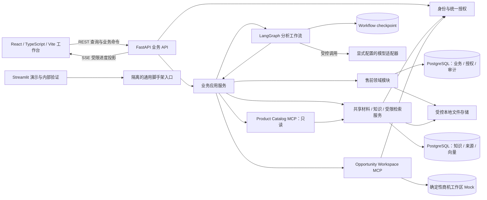
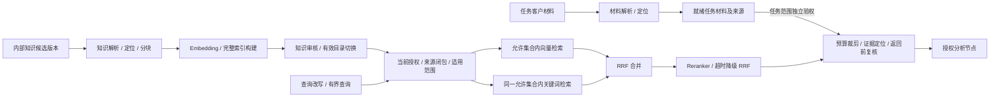

# 企业 AI 售前方案工作台：总体架构总览

- 文档版本：v0.2-review-draft。
- 更新日期：2026-11-11（Asia/Shanghai）。
- 状态：待架构评审；不是完整技术设计批准、开发授权或验收结论。
- 权威依据：[已批准业务需求基线](初版业务需求分析文档.md)、[需求决策索引](../../presales-requirements-decisions.md)、[领域术语](../../../GLOSSARY.md)。
- 详细设计记录：[总体技术设计与确认历史](总体技术设计方案.md)。
- UI方向：用户已确认双入口；接入顺序及工程约束见[双入口工作台与前端分阶段接入设计](双入口工作台与前端分阶段接入设计.md)。2A-0基础和2A-3最小材料/知识工作台已实现；分析运行页面、SSE、正式方案审批与发布页面尚未实现。

## 1. 目标与边界

本总览把已确认的技术方向收束为可评审的系统边界、模块职责、核心数据流、必须守住的不变量和分阶段交付路线。读者可用它判断整体结构是否能承载冻结的 v0.1 业务需求；数据库字段、事务细节、API 契约和执行恢复协议留在相应阶段方案中。

首版面向固定制造业场景的单租户本地演示。售前架构师先在授权商机下创建本地 Presales Task、准备材料和初步 Proposal Package；审核人随后单独批准精确的外部任务创建动作，系统才创建 External Task Record。之后架构师继续完善方案，审核人对固定 Proposal Version 和另一份明确的发布动作集合进行审批，再由确定性本地 MCP Mock 逐项执行和核实。外部任务创建批准不等于 Proposal Version 批准或正式发布批准。系统不替人承诺产品能力、价格、日期或合同义务。

本文引用 TD-001 至 TD-034 的已确认方向，其中核心UI安排已按2026-11-06的用户选择更新。方向确认不代表所有实现细节已经批准；截至2026-11-11，当前代码包含继承的FastAPI/LangGraph/Streamlit脚手架、阶段一基础、2A-0至2A-3工程基础，以及2B-0的Attempt契约、方案Schema、持久化与受控checkpoint提交适配。分析执行工作流、SSE运行页面、正式审批/发布流程和产品验收尚未完成。工程验证结果见相应交付记录，均不因本次文档同步而成为新近测试结果。

下文分别标明已批准需求/已确认方向、当前代码事实和阶段设计建议。目标图不表示能力已经实现；引用阶段稿不改变其批准状态。2026-11-10用户已确认增加二A/二B真实能力探针及其失败处理方式，具体边界见第7.1节；这不改变冻结验收阈值，也不授权本次调用真实服务。

## 2. 当前代码与目标结构

| 区域 | 当前可核验代码 | 目标职责 |
| --- | --- | --- |
| 服务入口 | `src/service/`提供通用Agent API；`src/presales/api/`已有登录/JWT、材料/草稿、知识治理、检索及证据读取路由，仍未形成完整分析运行时HTTP工作流 | 保留适用的FastAPI接入，所有售前操作进入业务应用服务并检查当前身份、权限和状态 |
| Agent/工作流 | `src/agents/` 是通用示例图和工具 | LangGraph 负责分析编排、节点执行、中断及恢复；业务记录仍由售前服务维护 |
| 材料/知识/索引 | `src/presales/materials/`、`knowledge/`、`indexing/`已有2A-1应用服务与持久化，含解析定位、知识审核和索引构建；未接入对应HTTP或页面，未实现2A-2检索 | 复用来源/权限体系，分别管理任务材料和已发布知识，向分析提供受限证据；知识审核不等于方案审批 |
| 持久化 | `src/memory/postgres.py` 封装 LangGraph PostgreSQL saver/store；阶段一新增独立 SQLAlchemy async engine 与 Alembic 迁移 | 独立管理工作流 checkpoint；业务记录由自己的数据库访问层和显式迁移负责 |
| Schema | `src/schema/` 以 Pydantic 请求/响应类型为主 | 继续承载接口 DTO；业务实体和数据库映射放在独立售前模块，避免把 API 类型当作持久化事实 |
| 客户端 | `src/streamlit_app.py`与`src/client/`提供通用聊天界面；`frontend/`已有认证基础及材料/知识审核、检索和证据定位页面，分析工作台尚未实现 | Streamlit用于聊天演示和内部验证；React + TypeScript + Vite逐阶段承担任务、证据、编辑、审批与发布恢复 |
| 数据库/文件 | `compose.yaml`声明`postgres:16`；`0004_knowledge`迁移要求PGVector 0.8.6；通用脚手架有多种checkpointer配置 | 售前目标为单PostgreSQL实例、按职责分schema；核定主版本及扩展兼容后统一开发/交付环境；客户文件和导出物放受控本地目录 |
| 外部工具 | 当前可见的是脚手架示例工具 | 两个项目本地 MCP Server 分别提供受限产品知识读取和确定性机会工作区 Mock；无真实 CRM |

此处描述目标归属，不表示以上售前能力已经实现。尤其现有 bearer key、请求中的 `user_id`、聊天 `thread_id` 和 checkpointer 不能直接代替业务 JWT、对象授权、Proposal Analysis Attempt 或审批门禁。

### 2.1 当前运行入口与交付差距

售前ASGI入口为`src/presales/asgi.py`；`src/run_service.py`仍启动通用`service:app`。现有`docker/Dockerfile.service`只复制脚手架模块并运行该脚本，未打包售前模块、迁移或React静态产物；Compose尚不代表双入口业务交付。后续需明确业务入口、前端静态资源接入、显式迁移、受控目录和健康检查，并在Linux VM验证。

数据库交付还需表达扩展依赖：`0004_knowledge.py`创建并检查PGVector 0.8.6，现有Compose仅声明`postgres:16`，未提供该扩展安装步骤。阶段一的PostgreSQL 18.6历史专项结果不证明当前Compose兼容；数据库主版本、扩展版本、迁移和镜像须共同验证，本次未启动容器或执行迁移。

售前入口的可选兼容模式默认关闭；启用时现有代码为通用演示装配独立SQLite checkpoint及内存store，并禁用通用tracing。该隔离例外不承载售前业务事实，也不表示目标工作流checkpoint已经接入PostgreSQL。兼容入口不得借通用身份访问售前对象。

## 3. 逻辑架构

业务应用服务是权限与状态转换的统一入口。Agent 可读取被授权的数据并提交分析结果或动作建议；不能绕过服务层直接变更业务状态、审批、读受限来源或执行未经批准的外部写入。文件、模型、checkpoint 与 MCP 之间没有隐式共同事务。

Streamlit若联调售前对象，必须调用相同业务API并使用业务身份，不能以脚手架身份读取售前数据。后台分析不依赖浏览器连接存活；断线后重新鉴权、读取当前快照再接收进度，快照/订阅交接须避免遗漏终态。SSE不替代业务记录或完整审计，现有通用AG-UI不直接承担售前审批与恢复。

### 3.1 模块职责

| 模块 | 负责内容 | 不拥有的事实 |
| --- | --- | --- |
| 身份与访问控制 | 验证 JWT 主体；读取当前角色和对象授权；按归属及所有实际输入来源检查访问 | 不把 token 内旧权限当作当前授权；不因 schema 分组自动放宽访问 |
| 商机与任务 | Opportunity、本地 Presales Task、与其关联但生命周期独立的 External Task Record、输入清单及任务生命周期 | 不把外部任务记录与本地任务合并；不把聊天线程当作任务身份 |
| 材料与知识 | Customer Material、Published Knowledge Version、证据定位及来源适用性 | 不让文件名、向量索引或模型引用替代来源身份 |
| 分析执行 | Proposal Analysis Attempt、LangGraph thread 映射、节点运行、取消和恢复 | checkpoint 不是业务审批、版本或发布结果的权威记录 |
| 方案与审阅 | Proposal Version、不可变内容修订、Review Record、Approval Record | 审批不授权批准清单以外的动作；追加审计不改写已批正文 |
| 发布与工具 | Approved Action Set、逐项调用身份、MCP 幂等、未知结果核实和恢复 | 不把部分成功标成完成；不连接真实 CRM |
| 业务记忆 | 有来源的商机/客户陈述、确认状态、有效性、冲突和复用范围 | 不把模型推断或过期内容当成确定事实 |

这些职责在同一服务/部署中通过模块边界实现，不新增微服务。具体包路径是阶段方案中的实现建议。

Product Catalog MCP复用共享知识应用服务、当前授权、目录和来源关系，不维护另一套产品事实库或ACL。Opportunity Workspace MCP读取合成商机背景，并在精确批准后执行确定性Mock写入。两者均重新检查可信调用身份与数据范围；模型不能自行提供actor或批准状态。二A建议由后端管理本地stdio子进程，跨平台启动与回收仍待验证，详见[二A工具边界](阶段二A-材料知识治理与受限检索设计方案.md)。

### 3.2 材料、索引与在线检索

以下链路依据需求第6/7节及二A设计。解析、知识治理和索引应用服务已有代码；在线受限检索及Product Catalog MCP尚未实现。

任务材料与共享知识保持不同归属：客户材料不因解析成功进入共享知识；内部候选须索引完整且审核发布后才能用于正式检索。权限过滤在两路候选形成前执行，未授权内容不能进入RRF、精排或模型。Product Catalog仅查已发布知识；任务材料经独立允许范围接入。证据ID由程序生成并指向固定来源版本及定位。

精排失败可见地退回RRF，仍执行证据门禁；缓存命中及返回/外发前复核当前授权与目录有效性。上下文不足以覆盖关键输入时要求分拆或更换配置，不能静默截断后宣称完整。精确向量检索、分词、候选数和缓存键等工程默认值由二A方案细化，不在此宣称召回或性能达标。

### 3.3 Agent数据依赖与校验

四类专业分析、汇总与至多一次自动修订来自已批准需求；下图的具体依赖顺序来自[二B待评审草稿](阶段二B-Agent分析工作流设计方案.md)，属于工程建议，不表示整份二B设计已批准。

各节点读取固定输入及所需上游产物，独立只读查询可在总预算内有界并发。Router只选择白名单分析计划，不能删去关键专家、增加写工具或开启无限循环。四类关键产出缺失时不能宣称方案完整；Reflection保留前后产物和修改依据，不自行接受风险、伪造客户确认或产生审批决定。引用可定位由程序校验，论断是否受证据支持另由真实能力评测及人工复核判断。

### 3.4 请求、后台执行与观察

后台寿命独立于浏览器是已确认方向；下表的监督器及命令交接是二B阶段建议，尚未实现。首版不新增队列服务或承诺高可用。

| 环节 | 职责与持久边界 |
| --- | --- |
| API受理 | 重新验权，在短事务中创建Attempt、任务/全局槽位、thread及命令回执；已受理不等于已生成结果 |
| 后台领取 | FastAPI生命周期内监督器在提交后领取；持久记录支持受理与派发之间崩溃的核对，不接受全局忙时排队 |
| 图执行 | 按当前Attempt及执行代次推进节点、checkpoint和业务产物；每次读取、调用及落稿检查当前权限、状态和预算 |
| 状态观察 | 业务数据库维护运行投影，React按二B协议完成当前快照与SSE的一致性交接；持续鉴权并消除快照/订阅竞争，不靠连接EOF判断成功 |
| 重启续跑 | 先核实checkpoint、在途调用及旧执行隔离；架构师重登后显式继续，重新占位，沿用原预算和修订次数；不能安全判定则待核实 |

数据库槽位是排他权威，进程内锁或租约超时不能单独证明旧执行已经停止。checkpoint提交边界必须拒绝旧代次；无法验证时阻断续跑。浏览器JWT自然到期不单独终止合法后台运行；发起人撤权则停止后续受限操作，旧尝试结果不得写入当前候选。

二B建议在草稿落库后结束正常分析，阶段三再接人工审阅审批；人工interrupt保留Attempt和输入锁、释放全局槽位，恢复前重新占位和鉴权。商机背景的必需性由架构师启动前明确并锁入输入快照：必需读取失败停止完整分析，可选失败才允许明确缺失后继续；未确认不自动按可选处理，成功空历史属于正常结果。重启续跑与背景必需性两项选择已有二B用户确认记录，其他工程细节继续按阶段评审。

## 4. 核心数据与权威来源

| 数据 | 权威来源 | 约束 |
| --- | --- | --- |
| 用户、角色、资源授权 | PostgreSQL 当前授权记录 | 三个预置账号各绑定一个角色；无匹配授权默认拒绝；重启不以种子配置覆盖已变更授权 |
| Opportunity、Presales Task 与 External Task Record | 本地 Opportunity/Presales Task 由 PostgreSQL 关系记录权威管理；External Task Record 由 Opportunity Workspace MCP 目标结果及本地核实记录共同追踪 | 本地任务和初步结果可先存在；精确创建动作须先有独立 External Task Creation Approval；创建批准不授权正式方案发布 |
| Proposal Version 内容 | 指定修订的 JSON/JSONB 快照 | 保存形成新修订；提交与批准绑定固定修订；正式批准正文不可变 |
| 来源依赖和 Evidence Snapshot | PostgreSQL 的直接依赖及版本关系 | 访问沿依赖追溯所有原始来源；未知、缺失、循环或权限不足时拒绝 |
| 知识有效性与检索索引 | PostgreSQL中的知识版本、审核记录、有效目录及完整索引构建 | 向量和排序分数不是产品事实；新索引就绪且审核通过才切换，停用排除新检索，历史依据仍受当前授权限制 |
| 审阅、审批与审计 | PostgreSQL 业务记录及追加事件 | 批准绑定精确快照与 Approved Action Set；审计追加，不修改历史正文 |
| 分析中间态 | LangGraph checkpoint | 服务端生成 thread 并绑定尝试；恢复前重新鉴权；checkpoint 不证明业务产物已就绪 |
| 文件正文 | 受控本地目录 | 业务身份、逻辑存储键、版本、校验和及来源在数据库登记；目录不作为公开静态资源 |
| Opportunity Workspace MCP写入结果 | 本地确定性Mock与业务核实记录 | 批准动作标识作为幂等键；不能验证幂等或结果未知时，不重复写入、不宣称发布完成 |

## 5. 端到端业务路径

1. 本地初始化演示 Opportunity 和授权；售前架构师在授权商机下创建 Presales Task，登记客户材料及来源声明；数据使用合成材料或获授权的公开/自有资料。
2. 后端保存来源身份、内容版本和归属，检查用户对商机、任务及材料的当前授权。
3. 创建 Proposal Analysis Attempt，绑定发起人、输入修订、来源范围及服务端生成的 LangGraph thread；通过统一的业务访问组件提供可见上下文。
4. 受限 Agent 生成带来源依据的覆盖结论、初步方案、风险和澄清项。结构化结果及其直接来源依赖按修订保存；失败、降级、未知和部分成功显式留痕。
5. 架构师提交独立的 External Task Creation Approval 请求，绑定目标、精确参数和来源范围；审核人批准后，发布服务才可通过 Opportunity Workspace MCP 创建 External Task Record。未批准或创建结果未知时，本地材料和方案仍保留，不能伪称外部任务已创建；该批准不授权方案发布。
6. External Task Record 创建并核实后，架构师处理证据、冲突、风险和澄清事项，编辑草稿并提交固定 Proposal Version 修订；审核人独立查看快照、风险、审阅结论和完整动作参数。
7. 审核人对精确 Proposal Version 和另一份 Approved Action Set 作出方案审批。业务数据库先保存审批和审计；需要恢复图时持久记录固定恢复意图及执行代次，再推进 checkpoint。方案审批不追溯授权外部任务创建。
8. 发布服务按批准的依赖顺序逐动作调用本地 MCP。相同动作复用稳定动作键；同键异参拒绝；未知结果按原键核实。只有方案发布清单内所有动作都确认成功才是 Publication Completion。
9. JSON、Markdown 和 HTML 从同一固定内容修订生成，另显示当前审计封套与发布状态；所有派生物继续受所有实际来源权限约束。

## 6. 跨阶段必须守住的不变量

- **身份和授权**：服务端验证 JWT，逐次读取当前角色、业务状态和资源授权；客户端自报用户或隐藏按钮不能授权。
- **来源和派生物**：每个结果保留直接输入依赖，读者必须同时有权访问结果归属对象及完整来源闭包；来源未知或不完整时拒绝。
- **版本和尝试**：Analysis Attempt、thread、任务、版本和内容修订身份互不替代；旧尝试、取消运行和旧回调不能覆盖当前候选。
- **审批和发布**：批准绑定固定修订、风险处置、目标和参数；审批/审计先落库；批准正文不可变；逐项成功、失败、未知和终止状态可追溯。
- **恢复和幂等**：重复恢复复用固定意图；fencing 代次必须在 checkpoint 持久化边界校验；动作键复用且参数摘要稳定；不能判定时保持待核实，不盲目重放。
- **数据真实性**：首版只用合成客户材料及获授权的公开/自有资料；Agent 输出和 Mock 能力不冒充真实客户事实或真实模型能力。
- **服务外发**：模型、Embedding、Reranker、Judge、观测及外部工具的接收端只能来自明确配置；文档或模型输出不能指定临时目的地址。读取权限不自动构成外发授权；默认观测关闭，或只发送不含客户正文和证据内容的必要元数据。
- **秘密和运行**：密钥由本地秘密配置提供，不进入种子、数据库审计或模型可见日志；默认工程测试不调用收费真实模型。
- **运行隔离**：Windows 原生运行用于日常开发；Linux VM 承担 Compose 交付验证；采用同一数据库目标主版本、迁移和业务规则减少差异。主版本选取是阶段一的工程建议，环境可用性仍待现场验证。

### 6.1 内容就绪与业务门禁

以下摘录需求第4/5/8/9节，完整转换和判定以需求基线为准，不新增或放宽业务规则。

| 事实层次 | 必须区分的判定 |
| --- | --- |
| 分析结束 | 节点结局、错误和降级可追溯；计算结束本身不证明必需产出完整或草稿已就绪 |
| 草稿就绪 | 完整Schema、内部关联、可解析引用及实际来源依赖满足契约；合法的不支持/待澄清结论可以保留，不伪造覆盖 |
| 允许提交 | 关键材料有效、关键冲突已解决、严重风险消除、中风险有处置、必须需求满足门禁；无未经确认的绑定承诺，当前权限与固定修订有效 |
| 正式批准 | 审核人独立决定；高风险及必须需求部分覆盖须明确接受，必须需求未覆盖/待澄清/范围外阻断；绑定精确快照和动作集合 |
| 发布完成 | 仅在批准清单全部动作核实成功后成立；方案已批准、部分写入成功均不能替代该事实 |

JSON/JSONB是内容源，Markdown/HTML从同一固定修订生成，追加审计封套另记时间和发布状态。结构完整、引用可定位不证明语义正确；Reflection不能自行解除业务阻断，工程自动化也不能替代真实能力评测。

### 6.2 首版资源边界

下表摘录已批准P08默认值；完整口径见[需求第11节](初版业务需求分析文档.md)。实际阈值配置化并记录，不表示已测吞吐或生产SLA。

| 边界 | 默认值与达限行为 |
| --- | --- |
| 文件与文本 | 每任务10文件；单文件20 MiB/任务50 MiB；单文件/任务解析字符100,000/300,000；超限拒绝或要求拆分，不静默截断 |
| 知识规模 | 100个文档版本、5,000个有效块以内；超限拒绝新批次，不删历史腾名额 |
| 活跃分析 | 同任务/全局各1；数据库持久占位，全局忙时拒绝，不提供队列 |
| 解析与索引 | 单文件解析60秒、单批索引10分钟；超时保留失败/未完成，半索引不发布 |
| 调用期限 | 生成120秒、Embedding 60秒、Reranker 3秒、MCP单动作10秒；精排超时降级，写入超时先核实 |
| Attempt预算 | 主动运行累计10分钟，不含人工等待和独立索引；重启续跑不清零，无法核实的执行区间保守计入 |
| 重试与修订 | 可重试技术错误初次后最多2次且受总期限限制；Reflection自动修订最多1次，不随技术重试扩大 |

## 7. 交付阶段与评审门槛

| 阶段 | 交付重点 | 进入下一阶段的证据 |
| --- | --- | --- |
| 0. 架构评审 | 本总览确认边界、模块责任、数据权威和阶段顺序 | 架构总览获评审接受；阶段一方案有明确审查结论 |
| 1. 基础设施与领域数据 | PostgreSQL/迁移、身份与授权核心、核心对象、草稿修订、来源、审计和文件就绪契约 | 阶段一实现与历史证据见实施清单：PostgreSQL 18.6专项52 passed、1 skipped，离线单测29 passed、1 skipped；本次未重跑。历史全量脚手架测试有Streamlit路径失败，整体评审与产品验收未完成 |
| 2A. 材料、知识治理与受限检索 | [阶段二A方案](阶段二A-材料知识治理与受限检索设计方案.md)：认证/入口隔离、最小React前端基础、材料/知识页面、解析、知识治理、双路检索与只读Product Catalog MCP；链路可用后增加第7.1节真实探针 | AC02-AC06、AC16检索/授权/缓存部分、AC22本阶段工程证据；二A外部前置交付记录了2A-2检索/MCP、2A-3页面/API和历史验证；D3样例复核、P07能力评测及二A阶段验收仍有独立边界，详见[交付记录](../../maintenance/phase2a-prerequisites-delivery-2026-11-11.md) |
| 2B. Agent 分析工作流与输出契约 | [阶段二B待评审草稿](阶段二B-Agent分析工作流设计方案.md)：复用2A前端和认证；Attempt/槽位/thread/取消、后台分析、快照API/SSE与运行页面、只读商机背景、专业分析、Reflection与完整Schema；增加第7.1节真实探针 | 2B-0的Attempt契约、Proposal Package Schema、持久化及checkpoint提交适配已有历史工程验证，见[交付记录](../../maintenance/phase2b-0-delivery-2026-11-11.md)；2B-1运行时、2B-2分析图与2B-3 SSE/运行页面仍未完成，二B待评审草稿及阶段验收状态不变 |
| 3. 审阅审批与恢复 | 草稿编辑/冲突、固定快照审阅审批页面、两类外部审批、恢复意图/fencing/回执、记忆治理及知识变化影响处理 | AC11、AC13、AC16提交/审批及历史影响、AC17、AC26；浏览器重试与崩溃点不能重复批准或盲目恢复 |
| 4. MCP 外部动作与发布恢复 | 独立外部任务创建与方案发布动作集、参数摘要、幂等核实；逐项结果、恢复/终止页面 | AC12、AC14、AC15、AC25；无可靠幂等/核实能力则阻断；刷新不重放成功写入 |
| 5. 工作台收口、导出与运行验证 | React整体体验、JSON/MD/HTML、双入口Compose交付、README、运行配置与独立真实能力评测 | 保留AC01的Streamlit检查，补React入口与业务链路验证；AC18、AC20、AC23、AC24及完整AC01-AC27；工程与真实能力结果分开 |

阶段方案先评审，再进入该阶段实现。阶段二A原v1.0定稿后补入前端增量；截至2026-11-11，认证、2A-0至2A-3工程基础已存在，二A整体未经阶段验收。阶段二B已有v0.1待评审草稿，2B-0工程基础已实现但分析运行链仍未完成，三至五细案继续滚动编制；二A/二B阶段稿后续修订须承接第7.1节探针安排。本次只同步当前状态和交付证据，不启动开发。总体架构批准、阶段方案定稿、开发授权和产品验收是不同状态。

阶段二保持2A/2B划分：2A交付最小前端基础，二B前完成；SSE随二B分析执行接入。三、四的业务API与相应React页面共同交付，五完成整体体验与交付验证。具体理由和检查边界统一见[双入口接入设计](双入口工作台与前端分阶段接入设计.md)。登录/JWT及通用入口隔离仍须先于业务HTTP开放。

### 7.1 二A/二B真实能力探针：已确认的路线增量

2026-11-10本轮架构讨论中，用户依次确认“增加早期探针、完整验收留阶段五”及“基本不可行先解决、语义质量差距留痕后可继续工程开发”。这是局部路线选择，不是完整架构或阶段方案批准，不改变P07的样本、三轮评测和冻结阈值。

| 时机 | 探针范围 | 留存证据 |
| --- | --- | --- |
| 二A受限检索链可用后 | 用真实配置检查中文证据召回、引用定位、精排降级及调用可行性 | 查询、允许来源、检索结果及人工相关性判断、实际配置、失败/降级和耗时 |
| 二B分析链可用后 | 检查模型关键结构化输出、上下文容量、四类分析与Reflection表现及运行预算 | 输入及Attempt身份、前后产物、引用/论断问题、错误、配置、耗时及可取得的用量/费用 |

执行前从已批准的10个开发样例中选少量并固定本次输入/检查项；开发样例尚未制作复核时先完成准备，不虚构已有数据。不得使用20个冻结验收样例的标签调优。具体样例数、模型、端点、允许数据、调用次数及预算随专项计划明确，实际调用须另行显式授权；不进入默认工程测试，不在本次文档修订中启动。

结果按下列规则处理：

- 基本不可行：关键结构化产出持续不可用、关键输入无法容纳、必要链路无法在预算内运行等，先解决再推进依赖该能力的工作；不能用Fake替代真实失败。
- 语义质量差距：链路可运行但召回、覆盖判断或Reflection效果不足时，保留失败样例、差距及后续改进项，可以继续工程开发；不宣称能力或阶段验收已通过。
- 工程硬门禁失败：越权、未经授权外发/写入、审批绕过等始终阻断相关执行及推进，不能归入可延后质量问题；未知执行结果仍按原规则核实。

探针报告与工程测试、阶段五能力报告分开；保留所有成功、失败和降级，不删除差例、择优报分、静默切换模式或事后降低阈值。阶段五仍使用冻结验收集逐轮检查完整指标，探针通过不替代最终验收。

## 8. 决策记录与评审事项

TD-001 至 TD-034 的方向已逐项确认，但完整技术设计尚未批准。详细依据、替代方案和确认原文见[总体技术设计](总体技术设计方案.md)及其关联 ADR；本总览不再把每个 SQL、字段或异常处理细节转成业务问卷。

评审时重点检查：

- 业务、授权、审计、知识和 checkpoint 的事实边界与模块责任是否清楚，External Task Record 是否始终与 Presales Task 和 Proposal Version 区分；
- 外部任务创建审批与方案发布审批是否保持独立，外发接收端是否经过显式配置；
- 单服务/单 PostgreSQL 的阶段顺序能否在冻结需求约束下渐进交付；
- 知识索引与受限检索、四类专业分析及校验门禁是否连成可追溯链路，两个MCP是否复用正确的数据权威；
- 请求受理、后台寿命、状态观察和重启续跑是否职责分离，且不引入隐式队列或放松排他；
- Windows开发与Linux Compose验证是否能共用数据库主版本、PGVector版本和迁移，当前交付差距是否明确；
- 二A/二B探针是否在明确授权下执行、失败是否如实留存，并保持阶段五冻结验收独立；
- 阶段一边界是否足以支撑后续工作流，且不会提前实现 Agent/MCP/UI 全链路。

后续实现技术选择由阶段方案给出有理由的默认值。只有业务可见行为、权限、不可逆高影响取舍或架构边界发生变化时，再请求用户决策；其余实现细节由工程方案承担并记录理由。

### 8.1 跨阶段技术门禁

以下验证属于待完成工作，不是当前通过结论；协议细节保留在对应阶段设计。

| 风险/依赖 | 必须取得的证据 | 不满足时的处理 |
| --- | --- | --- |
| 数据库与实际交付 | 核定主版本、PGVector、迁移及权限；镜像含业务入口、静态产物与受控文件配置 | 不宣称Compose业务交付可用；保留现状与目标差距 |
| checkpoint代次隔离 | 锁定saver版本在checkpoint及pending writes提交边界拒绝旧代次，回执同样受限 | 阻断受控续跑，不能以调用前检查代替提交边界校验 |
| 二A到二B契约 | 真实业务API、受限检索、稳定证据ID及当前授权集成；阶段一草稿与完整Schema显式区分 | 不私建第二套检索/ACL，不静默补空字段冒充完整产物 |
| MCP身份与幂等 | stdio寿命/凭证隔离；写工具具备持久幂等、同键异参拒绝与按键核实 | 读失败与空结果区分；无可靠写入核实能力则阻断，未知结果不盲重放 |
| 前端观察与内容渲染 | 快照/SSE竞争、到期/撤权、终态可见及模型/材料文本安全渲染 | 不靠旧缓存或连接结束宣称成功，不开放完整graph state绕过业务授权 |

## 滚动式规划执行说明

2026-11-03用户选择逐阶段规划/实施并授权阶段一，历史证据见[阶段一实施清单](../plans/2026-11-03-phase-one-implementation.md)；随后阶段二A形成v1.0。2026-11-06用户确认双入口和React/TS/Vite、REST/SSE路线并要求更新文档，前端基础安排在二A、SSE安排在二B。2026-11-10静态复核：2A-0最小React工程和2A-1应用服务已有代码（2A-1见[交付记录](../../maintenance/phase2a1-delivery-2026-11-06.md)），SSE、业务页面及2A-2检索仍未实现；二B已有待评审草稿，分析链未实现。上述均为工程现状，不是阶段验收。

同日用户在总体架构审视中确认第7.1节两项探针选择，并要求完善本文。v0.2补充知识/检索与Agent依赖视图、后台运行边界、内容门禁、资源约束及交付差距，修复交付记录链接；本轮只更新总览，未修改用户已有二B草稿、业务代码、需求基线或阶段完成状态，未启动模型、部署或业务验收。

同日后续按用户要求同步二B待评审草稿，已承接第7.1节的二B探针路线、二A探针依赖核对及失败处理；二A阶段稿仍待单独同步。本文仅修复重命名后的技术设计链接，并将状态观察统一为按二B协议完成快照/SSE一致性交接，不另行规定相反的交接顺序。二B仍为v0.1-review-draft、待评审，未启动真实调用或更新阶段完成状态。
